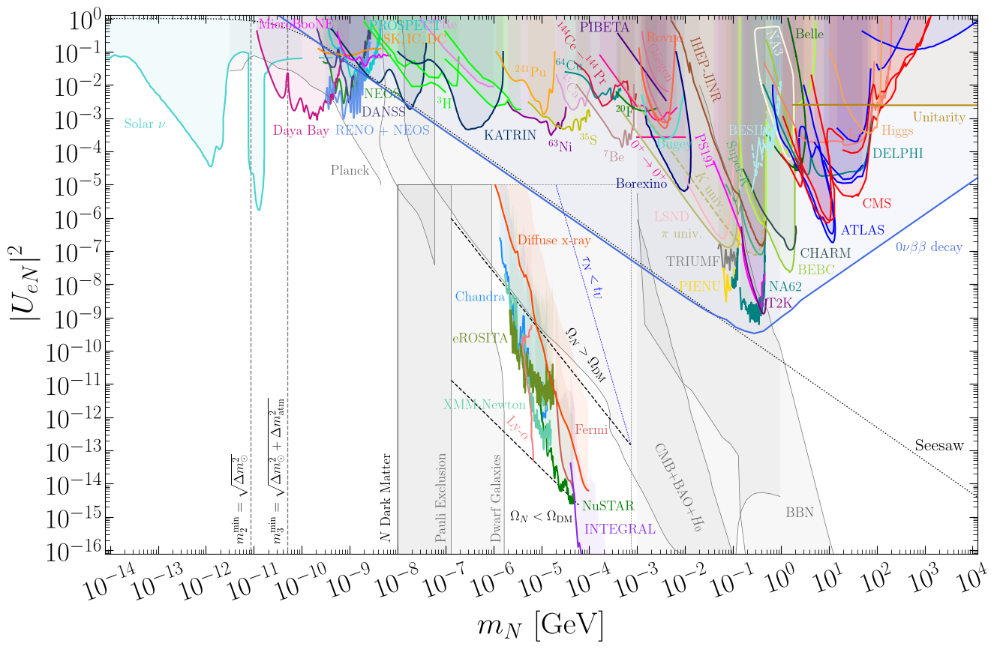
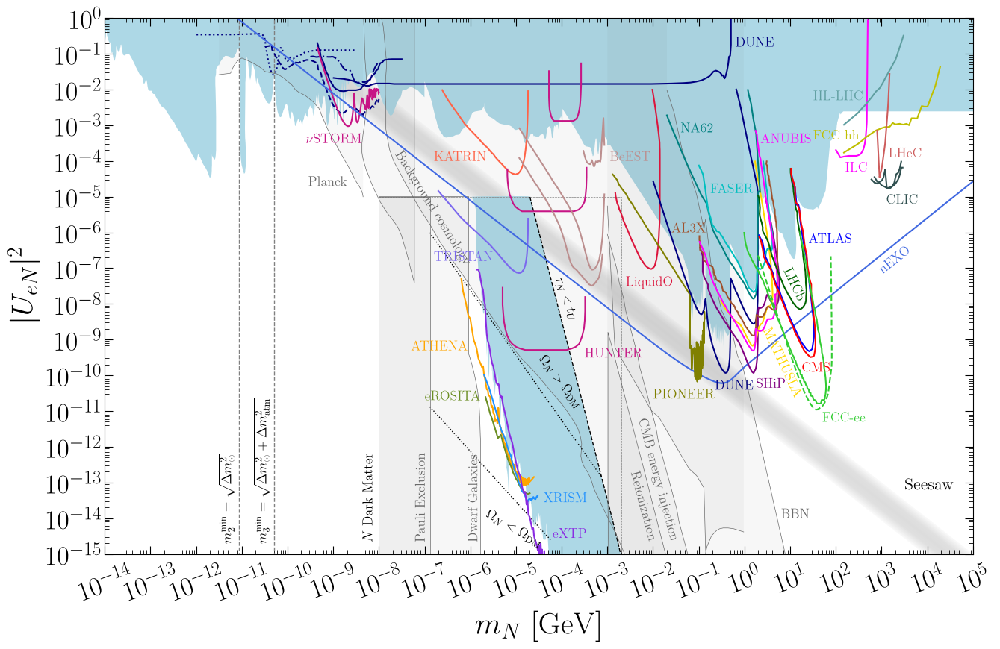

# Sterile Neutrino/Heavy Neutral Lepton Constraints

This repository lists the current constraints and future sensitivities on the active-sterile mixing between three active neutrino flavours of the Standard Model ($\nu_e$, $\nu_\mu$ and $\nu_\tau$) and a heavy neutral lepton ($N$). Limits on $|U_{eN}|^2$, $|U_{\mu N}|^2$ and $|U_{\tau N}|^2$ are given as a function of the HNL in the range . These constraints were originally collected in the paper [1912.03058](https://arxiv.org/abs/1912.03058) and hosted at the [webpage](https://www.hep.ucl.ac.uk/~pbolton/). This repository provides an updated database of constraints.

### [**Electron mixing**](docs/electron_mixing)

Current constraints ([pdf](https://github.com/PatrickBolton/SterileNeutrinoConstraints/raw/master/plots/UeNsq_constraints.pdf), [png](https://github.com/PatrickBolton/SterileNeutrinoConstraints/raw/master/plots/UeNsq_constraints.png))

Future sensitivities ([pdf](https://github.com/PatrickBolton/SterileNeutrinoConstraints/raw/master/plots/UeNsq_future.pdf), [png](https://github.com/PatrickBolton/SterileNeutrinoConstraints/raw/master/plots/UeNsq_future.png))

### [**Muon mixing**](docs/muon_mixing)

### [**Tau mixing**](docs/tau_mixing)