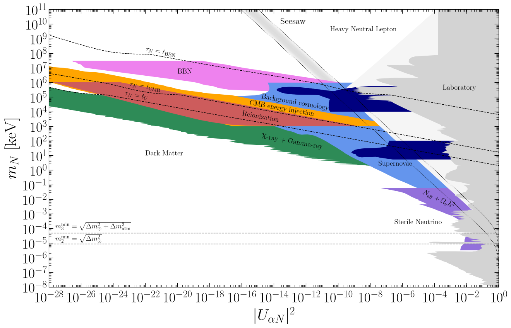
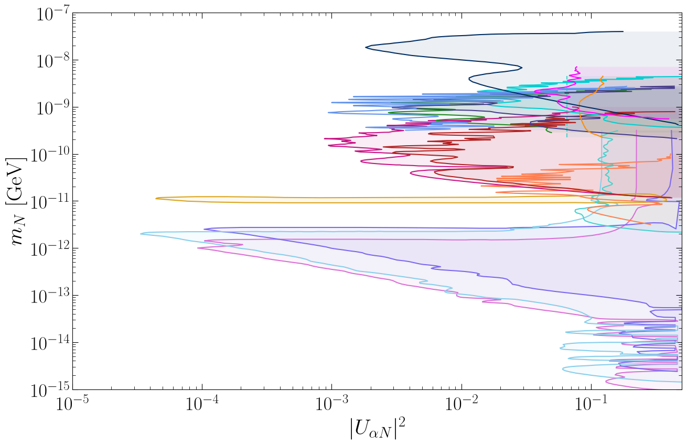
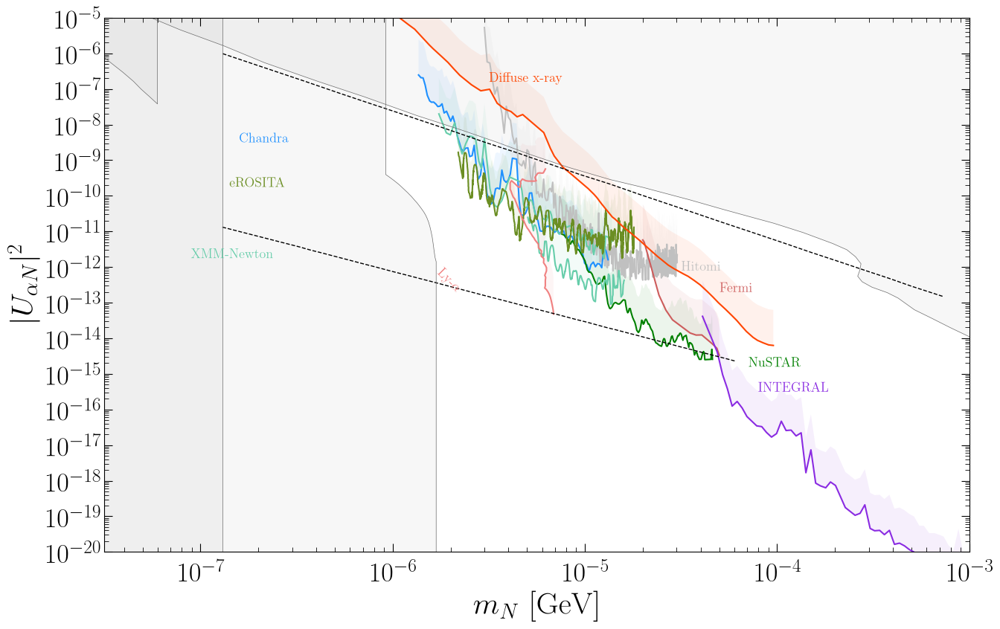
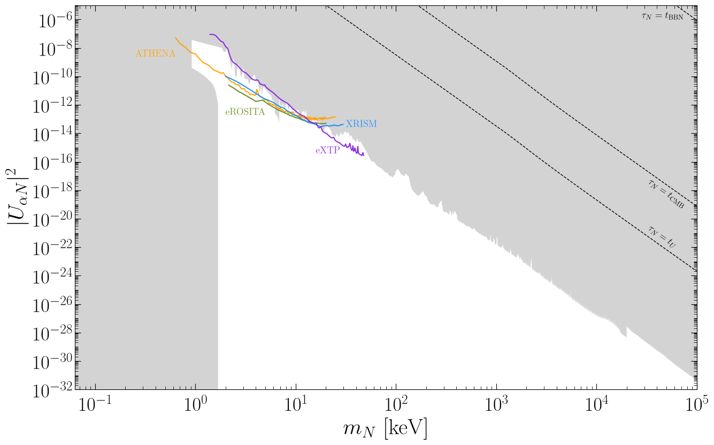

# Sterile Neutrino Constraints

This repository lists the current terrestrial, astrophysical and cosmological constraints and future sensitivities on the **active-sterile mixing** between the three active neutrino flavours of the Standard Model ($\nu_e$, $\nu_\mu$, and $\nu_\tau$) and a single sterile neutrino. The active neutrinos are composed of mass eigenstates as

$$ \nu_\alpha = \sum_i^3 U_{\alpha i} \nu_i + U_{\alpha N} N + \ldots,$$

where $\alpha = e,\mu,\tau$. The state $N$ is often called a **sterile neutrino** (despite having a small active component) or **heavy neutral lepton** (HNL) for $m_N \gtrsim 1 \ \text{MeV}$. The ellipses denote that additional massive states could be present, but are not considered explicitly here. In ``data``, limits on $|U_{eN}|^2$, $|U_{\mu N}|^2$ and $|U_{\tau N}|^2$ are given as a function of the sterile neutrino mass in the range $10 \ \mu \text{eV} < m_N < 100 \ \text{TeV}$. These constraints were originally collected for the paper [[1](#ref-1)] and hosted at this [webpage](https://www.hep.ucl.ac.uk/~pbolton/). This repository is an updated database and corrects previous errors. For other reviews on the sterile neutrino parameter space, see [[2](#ref-2)-[14](#ref-14)].

For any queries, comments or additional constraints that you think should be included here, contact me at patrick.d.bolton@gmail.com. If you use any of the bounds here, please cite the original work, with the reference provided in ``docs``.

## Mixing landscape

## Assumptions

We consider the phenomenological scenario of a massive **Majorana** fermion $N$ with a **single flavour** of active-sterile mixing. For an arbitrary number of sterile states, we have the relation

$$ \sum_i^3 U_{\alpha i}^2 m_i + U_{\alpha N}^2 m_N + \ldots = 0 . \quad(1)$$

A single $N$ cannot generate masses for two of the light neutrinos and therefore is incompatible with neutrino oscillation data. Nevertheless, it provides a useful benchmark for experimental searches, and the bounds can be rescaled appropriately in the context of a specific neutrino mass model. 

We make the additional clarifications:

### Confidence levels

For the limits and sensitivities presented here, we have taken the bounds from an extremely wide array of experimental and theory papers, often using slightly different statistical methods and confidence levels (CLs). We make no attempt to standardise the limits, and simply show the bound presented in each paper.

### Active-sterile neutrino oscillations

Bounds from active-sterile oscillation searches are often given in terms of $\Delta m_{41}^2 = m_4^2 - m_1^2$ and $\sin^2 2\theta_{i4}$ for $i = 1,2,3$. To show these bounds, we assume the normal ordering of neutrino masses ($m_1 < m_2 < m_3$) and take the lightest neutrino to be massless, $m_1 = 0$. Thus, the sterile neutrino mass and active-sterile mixing are determined by

$$m_N = \sqrt{\Delta m_{41}^2} , \quad |U_{\alpha N}|^2 = \sin^2\theta_{\alpha 4} = \frac{1}{2}- \frac{1}{2}\sqrt{1-\sin^22\theta_{\alpha 4}},$$

respectively, where $\theta_{e 4} = \theta_{14}$, $\theta_{\mu 4} = \theta_{24}$ and $\theta_{\tau 4} = \theta_{34}$. Note that the above relation for $\sin^2\theta_{\alpha 4}$ is only valid for $\theta_{\alpha 4}\leq \pi/4$, and thus we only show these bounds for $|U_{\alpha N}|^2 \leq 1/2$. The scenario $m_N > m_{2,3}$ is not strictly required in the model, and we also consider $m_N < m_{2,3}$ in the plots below.

### Seesaw prediction

We show values of the active-sterile mixing which generate the correct order-of-magnitude mass for one of the light neutrinos ($\nu$). From the relation Eq. (1), we have

$$|U_{\alpha N}|^2 = \frac{m_\nu}{m_\nu + m_N}.$$

In the plots below we show this relation as a grey band, with the lower edge corresponding to the light neutrino mass $m_\nu = \sqrt{\Delta m_{\odot}^2} = 8.7\times 10^{-3} \ \text{eV}$ and the upper edge to $m_\nu = 0.1 \ \text{eV}$.

### Neutrinoless double beta decay

We show the bounds from the non-observation of neutrinoless double beta ($0\nu\beta\beta$) decay in $^{136}\text{Xe}$ and $^{76}\text{Ge}$ at the KamLAND-Zen and LEGEND experiments, respectively, setting the lower bounds

$$ T_{1/2}^{0\nu}(^{136}\text{Xe}) > 3.8 \times 10^{26} \ \text{yr} ,$$
$$ T_{1/2}^{0\nu}(^{76}\text{Ge}) > 1.9 \times 10^{26} \ \text{yr} ,$$

at 90\% CL [[15](#ref-15), [16](#ref-16)]. We also consider the future sensitivity of the nEXO experiment [[17](#ref-17)], $T_{1/2}^{0\nu}(^{136}\text{Xe}) \gtrsim 10^{28} \ \text{yr}$. In the presence of a single heavy Majorana neutrino, the $0\nu\beta\beta$ decay half-life is given by

$$(T_{1/2}^{0\nu})^{-1} = \frac{G_{01} |V_{ud}|^4 g_A^4}{m_e^2} \Big|\sum_i^3 U_{ei}^2 m_i A_\nu(0) + U_{eN}^2 m_N A_\nu(m_N)\Big|^2 ,$$

where $G_{01}$ is an isotope-dependent phase-space factor, $V_{ud} = 0.97$ and $g_A = 1.27$. Here, $A_\nu(m_N)$ includes the dependence on the nuclear matrix elements (NMEs) and low-energy constants associated with hard neutrino exchange. We take the parametrisation for $A_\nu(m_N)$ from [[18](#ref-18)] and the NMEs from [[19](#ref-19)].

We further assume that the contribution of $N$ dominates over the light neutrinos. This is justified by the bounds not yet reaching the half-life range expected for normally-ordered light neutrinos. For example, assuming normal ordering and $m_1 = 0$, the half-life range $3.9 \times 10^{28} \ \text{yr} < T_{1/2}^{0\nu} < 2.5 \times 10^{29} \ \text{yr}$ is predicted for $^{136}\text{Xe}$. For $m_N \lesssim 0.1 \ \text{GeV}$, an additional effect can also impact the bound; if only $N$ is present, the relation Eq. (1) leads to a cancellation between light and heavy states and suppresses the $0\nu\beta\beta$ decay rate. We assume that this cancellation does not occur, and that $N$ still dominates the $0\nu\beta\beta$ decay half-life in this regime. The resulting bounds on $|U_{eN}|^2$ are shown as medium blue solid/dashed lines.

---

### [Electron mixing](docs/electron.md)  - $|U_{eN}|^2$

[Data files](docs/electron.md)\
Current limits ([pdf](https://raw.githubusercontent.com/PatrickBolton/SterileNeutrinoConstraints/main/plots/UeNsq_constraints.pdf), [png](https://raw.githubusercontent.com/PatrickBolton/SterileNeutrinoConstraints/main/plots/UeNsq_constraints.png))\
Future sensitivities ([pdf](https://raw.githubusercontent.com/PatrickBolton/SterileNeutrinoConstraints/main/plots/UeNsq_future.pdf), [png](https://raw.githubusercontent.com/PatrickBolton/SterileNeutrinoConstraints/main/plots/UeNsq_future.png))

                     

---

### [Muon mixing](docs/muon.md) - $|U_{\mu N}|^2$

[Data files](docs/muon.md)\
Current limits ([pdf](https://raw.githubusercontent.com/PatrickBolton/SterileNeutrinoConstraints/main/plots/UmuNsq_constraints.pdf), [png](https://raw.githubusercontent.com/PatrickBolton/SterileNeutrinoConstraints/main/plots/UmuNsq_constraints.png))\
Future sensitivities ([pdf](https://raw.githubusercontent.com/PatrickBolton/SterileNeutrinoConstraints/main/plots/UmuNsq_future.pdf), [png](https://raw.githubusercontent.com/PatrickBolton/SterileNeutrinoConstraints/main/plots/UmuNsq_future.png))

                     

---

### [Tau mixing](docs/tau.md) - $|U_{\tau N}|^2$

[Data files](docs/tau.md)\
Current limits ([pdf](https://raw.githubusercontent.com/PatrickBolton/SterileNeutrinoConstraints/main/plots/UtauNsq_constraints.pdf), [png](https://raw.githubusercontent.com/PatrickBolton/SterileNeutrinoConstraints/main/plots/UtauNsq_constraints.png))\
Future sensitivities ([pdf](https://raw.githubusercontent.com/PatrickBolton/SterileNeutrinoConstraints/main/plots/UtauNsq_future.pdf), [png](https://raw.githubusercontent.com/PatrickBolton/SterileNeutrinoConstraints/main/plots/UtauNsq_future.png))

                     

---

### [Sterile Neutrino Dark Matter](docs/DM.md)

[Data files](docs/DM.md)\
Current limits ([pdf](https://raw.githubusercontent.com/PatrickBolton/SterileNeutrinoConstraints/main/plots/UeNsq_constraints.pdf), [png](https://raw.githubusercontent.com/PatrickBolton/SterileNeutrinoConstraints/main/plots/UeNsq_constraints.png))\
Future sensitivities ([pdf](https://raw.githubusercontent.com/PatrickBolton/SterileNeutrinoConstraints/main/plots/UeNsq_future.pdf), [png](https://raw.githubusercontent.com/PatrickBolton/SterileNeutrinoConstraints/main/plots/UeNsq_future.png))

                     

## References

1. P. D. Bolton, F. F. Deppisch and P. S. Bhupal Dev,
"Neutrinoless double beta decay versus other probes of heavy sterile neutrinos,"
JHEP **03** (2020), 170
[doi:10.1007/JHEP03(2020)170](https://doi.org/10.1007/JHEP03(2020)170)
[[arXiv:1912.03058 [hep-ph]]](https://arxiv.org/abs/1912.03058).
2. A. Y. Smirnov and R. Zukanovich Funchal,
"Sterile neutrinos: Direct mixing effects versus induced mass matrix of active neutrinos,"
Phys. Rev. D **74** (2006), 013001
[doi:10.1103/PhysRevD.74.013001](https://doi.org/10.1103/PhysRevD.74.013001)
[[arXiv:hep-ph/0603009 [hep-ph]]](https://arxiv.org/abs/hep-ph/0603009).
3. A. Atre, T. Han, S. Pascoli and B. Zhang,
"The Search for Heavy Majorana Neutrinos,"
JHEP **05** (2009), 030
[doi:10.1088/1126-6708/2009/05/030](https://doi.org/10.1088/1126-6708/2009/05/030)
[[arXiv:0901.3589 [hep-ph]]](https://arxiv.org/abs/0901.3589).
4. F. F. Deppisch, P. S. Bhupal Dev and A. Pilaftsis,
"Neutrinos and Collider Physics,"
New J. Phys. **17** (2015) no.7, 075019
[doi:10.1088/1367-2630/17/7/075019](https://doi.org/10.1088/1367-2630/17/7/075019)
[[arXiv:1502.06541 [hep-ph]]](https://arxiv.org/abs/1502.06541).
5. A. de Gouvêa and A. Kobach,
"Global Constraints on a Heavy Neutrino,"
Phys. Rev. D **93** (2016) no.3, 033005
[doi:10.1103/PhysRevD.93.033005](https://doi.org/10.1103/PhysRevD.93.033005)
[[arXiv:1511.00683 [hep-ph]]](https://arxiv.org/abs/1511.00683).
6. D. A. Bryman and R. Shrock,
"Constraints on Sterile Neutrinos in the MeV to GeV Mass Range,"
Phys. Rev. D **100** (2019), 073011
[doi:10.1103/PhysRevD.100.073011](https://doi.org/10.1103/PhysRevD.100.073011)
[[arXiv:1909.11198 [hep-ph]]](https://arxiv.org/abs/1909.11198).
7. M. Chrzaszcz, M. Drewes, T. E. Gonzalo, J. Harz, S. Krishnamurthy and C. Weniger,
"A frequentist analysis of three right-handed neutrinos with GAMBIT,"
Eur. Phys. J. C **80** (2020) no.6, 569
[doi:10.1140/epjc/s10052-020-8073-9](https://doi.org/10.1140/epjc/s10052-020-8073-9)
[[arXiv:1908.02302 [hep-ph]]](https://arxiv.org/abs/1908.02302).
8. A. M. Abdullahi, P. B. Alzas, B. Batell, J. Beacham, A. Boyarsky, S. Carbajal, A. Chatterjee, J. I. Crespo-Anadon, F. F. Deppisch and A. De Roeck, *et al.*,
"The present and future status of heavy neutral leptons,"
J. Phys. G **50** (2023) no.2, 020501
[doi:10.1088/1361-6471/ac98f9](https://doi.org/10.1088/1361-6471/ac98f9)
[[arXiv:2203.08039 [hep-ph]]](https://arxiv.org/abs/2203.08039).
9. E. Fernández-Martínez, M. González-López, J. Hernández-García, M. Hostert and J. López-Pavón,
"Effective portals to heavy neutral leptons,"
JHEP **09** (2023), 001
[doi:10.1007/JHEP09(2023)001](https://doi.org/10.1007/JHEP09(2023)001)
[[arXiv:2304.06772 [hep-ph]]](https://arxiv.org/abs/2304.06772).
10. ATLAS Collaboration, "Summary plots for Heavy Neutral Leptons,"
[ATL-PHYS-PUB-2025-038](https://atlas.web.cern.ch/Atlas/GROUPS/PHYSICS/PUBNOTES/ATL-PHYS-PUB-2025-038/).
11. CMS Collaboration, "Heavy Neutral Lepton summary plots,"
[EXO-23-006](https://cms-summary-searches.docs.cern.ch/hnl_summary/).
12. A. Kusenko,
"Sterile neutrinos: The Dark side of the light fermions,"
Phys. Rept. **481** (2009), 1-28
[doi:10.1016/j.physrep.2009.07.004](https://doi.org/10.1016/j.physrep.2009.07.004)
[[arXiv:0906.2968 [hep-ph]]](https://arxiv.org/abs/0906.2968).
13. M. Drewes, T. Lasserre, A. Merle, S. Mertens, R. Adhikari, M. Agostini, N. A. Ky, T. Araki, M. Archidiacono and M. Bahr, *et al.*,
"A White Paper on keV Sterile Neutrino Dark Matter,"
JCAP **01** (2017), 025
[doi:10.1088/1475-7516/2017/01/025](https://doi.org/10.1088/1475-7516/2017/01/025)
[[arXiv:1602.04816 [hep-ph]]](https://arxiv.org/abs/1602.04816).
14. A. Boyarsky, M. Drewes, T. Lasserre, S. Mertens and O. Ruchayskiy,
"Sterile neutrino Dark Matter,"
Prog. Part. Nucl. Phys. **104** (2019), 1-45
[doi:10.1016/j.ppnp.2018.07.004](https://doi.org/10.1016/j.ppnp.2018.07.004)
[[arXiv:1807.07938 [hep-ph]]](https://arxiv.org/abs/1807.07938).
15. S. Abe *et al.* [KamLAND-Zen],
"Search for Majorana Neutrinos with the Complete KamLAND-Zen Dataset,"
Phys. Rev. Lett. **135** (2025) no.26, 262501
[doi:10.1103/jkf6-48j8](https://doi.org/10.1103/jkf6-48j8)
[[arXiv:2406.11438 [hep-ex]]](https://arxiv.org/abs/2406.11438).
16. H. Acharya *et al.* [LEGEND],
"First Results on the Search for Lepton Number Violating Neutrinoless Double-$\beta$ Decay with the LEGEND-200 Experiment,"
Phys. Rev. Lett. **136** (2026) no.2, 022701
[doi:10.1103/25tk-nctn](https://doi.org/doi:10.1103/25tk-nctn)
[[arXiv:2505.10440 [hep-ex]]](https://arxiv.org/abs/2505.10440).
17. G. Adhikari *et al.* [nEXO],
"nEXO: neutrinoless double beta decay search beyond $10^{28}$ year half-life sensitivity,"
J. Phys. G **49** (2022) no.1, 015104,
[doi:10.1088/1361-6471/ac3631](https://doi.org/doi:10.1088/1361-6471/ac3631)
[[arXiv:2106.16243 [nucl-ex]]](https://arxiv.org/abs/2106.16243).
18. W. Dekens, J. de Vries, D. Castillo, J. Menéndez, E. Mereghetti, V. Plakkot, P. Soriano and G. Zhou,
"Neutrinoless double beta decay rates in the presence of light sterile neutrinos,"
JHEP **09** (2024), 201
[doi:10.1007/JHEP09(2024)201](https://doi.org/doi:10.1007/JHEP09(2024)201)
[[arXiv:2402.07993 [hep-ph]]](https://arxiv.org/abs/2402.07993).
19. J. Menéndez,
"Neutrinoless $\beta\beta$ decay mediated by the exchange of light and heavy neutrinos: The role of nuclear structure correlations,"
J. Phys. G **45** (2018) no.1, 014003
[doi:10.1088/1361-6471/aa9bd4](https://doi.org/doi:10.1088/1361-6471/aa9bd4)
[[arXiv:1804.02105 [nucl-th]]](https://arxiv.org/abs/1804.02105).