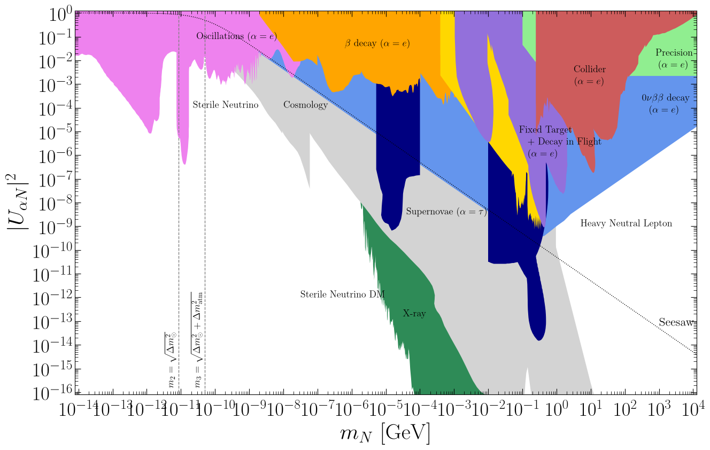
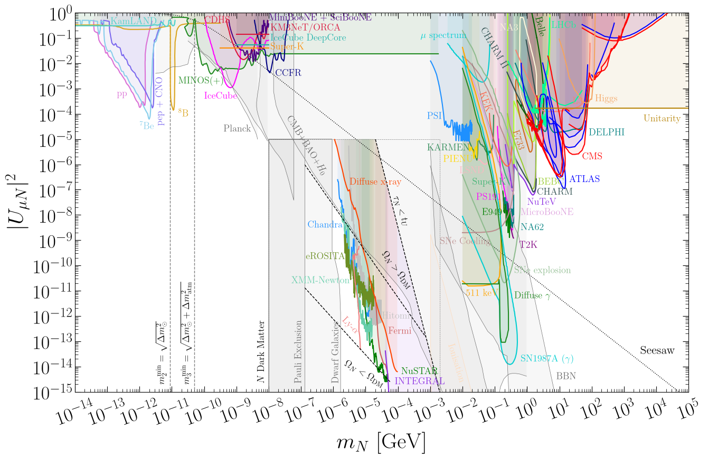
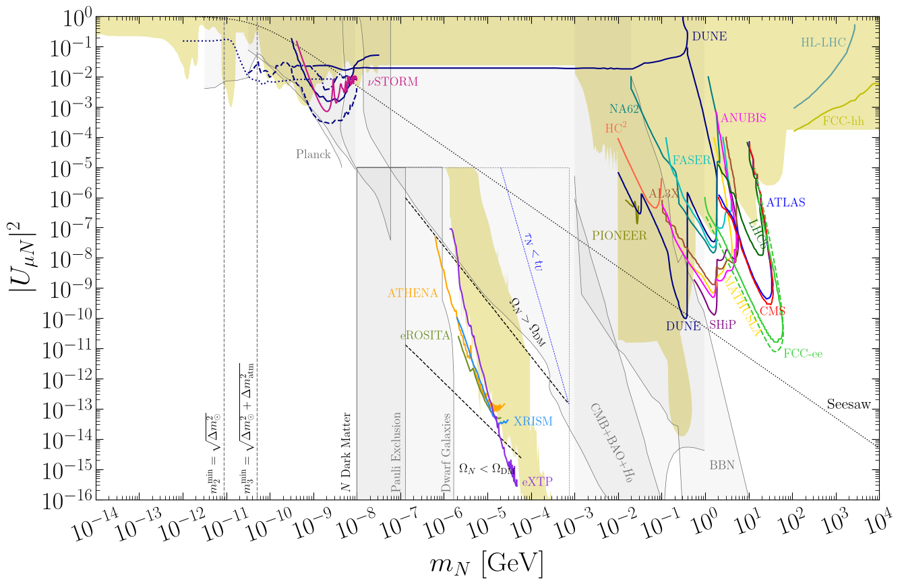

# Sterile Neutrino Constraints

This repository lists the current terrestrial, astrophysical and cosmological constraints and future sensitivities on the **active-sterile mixing** between the three active neutrino flavours of the Standard Model ($\nu_e$, $\nu_\mu$, and $\nu_\tau$) and a single sterile neutrino flavour ($\nu_s$). The active and sterile states mix to yield the mass eigenstates as

$$ \nu_\alpha = \sum_i^3 U_{\alpha i} \nu_i + U_{\alpha N} N,$$

where $\alpha = e,\mu,\tau$. The state $N$ is often called a **sterile neutrino** (despite having a small active component) or **heavy neutral lepton** for $m_N \gtrsim 1~\text{MeV}$. Here, limits on $|U_{eN}|^2$, $|U_{\mu N}|^2$ and $|U_{\tau N}|^2$ are given as a function of the sterile neutrino mass in the range $10~\mu \text{eV} < m_N < 10~\text{TeV}$. These constraints were originally collected for the paper [1912.03058](https://arxiv.org/abs/1912.03058) and hosted at this [webpage](https://www.hep.ucl.ac.uk/~pbolton/). This repository is an updated database and has made corrections where errors were spotted.

For any queries, comments or additional constraints that should be included here, contact me at patrick.d.bolton@gmail.com.

# Model Assumptions

We consider the phenomenological scenario of a massive Majorana fermion $N$ with a single flavour of active-sterile mixing. This setup cannot generate masses for two of the light neutrinos, and therefore is incompatible with the neutrino oscillation data. Nevertheless, it provides a useful benchmark for experimental searches, and the bounds can be rescaled appropriately in the context of a specific neutrino mass model.

Bounds from active-sterile neutrino oscillation searches are often given in terms of the mass squared splitting $\Delta m_{41}^2$ and mixing $\sin^2 2\theta_{i4}$. To plot these bounds, we assume the normal ordering of neutrino masses and take the lightest neutrino to be massless, $m_1 = 0$. Thus, the sterile neutrino mass and active-sterile mixing are determined as

$$m_N = \sqrt{\Delta m_{41}^2} ~, \quad |U_{\alpha N}|^2 = \sin^2\theta_{\alpha 4} = \frac{1}{2}- \frac{1}{2}\sqrt{1-\sin^22\theta_{\alpha 4}} \approx \frac{1}{4}\sin^22\theta_{\alpha 4} ~,$$

respectively, where $\theta_{e 4} = \theta_{14}$, $\theta_{\mu 4} = \theta_{24}$ and $\theta_{\tau 4} = \theta_{34}$.

# Mixing Landscape

Below, the general landscape of current bounds are shown for different active flavours.

# Electron Mixing

<!-- ### [**Electron mixing**](docs/electron_mixing) -->

Current constraints ([pdf](https://raw.githubusercontent.com/PatrickBolton/SterileNeutrinoConstraints/main/plots/UeNsq_constraints.pdf), [png](https://raw.githubusercontent.com/PatrickBolton/SterileNeutrinoConstraints/main/plots/UeNsq_constraints.png))\
Future sensitivities ([pdf](https://raw.githubusercontent.com/PatrickBolton/SterileNeutrinoConstraints/main/plots/UeNsq_future.pdf), [png](https://raw.githubusercontent.com/PatrickBolton/SterileNeutrinoConstraints/main/plots/UeNsq_future.png))

[

](docs/electron_mixing.md)

[

](docs/electron_mixing.md)

# Muon Mixing

<!-- ### [**Muon mixing**](docs/muon_mixing) -->

Current constraints ([pdf](https://raw.githubusercontent.com/PatrickBolton/SterileNeutrinoConstraints/main/plots/UmuNsq_constraints.pdf), [png](https://raw.githubusercontent.com/PatrickBolton/SterileNeutrinoConstraints/main/plots/UmuNsq_constraints.png))\
Future sensitivities ([pdf](https://raw.githubusercontent.com/PatrickBolton/SterileNeutrinoConstraints/main/plots/UmuNsq_future.pdf), [png](https://raw.githubusercontent.com/PatrickBolton/SterileNeutrinoConstraints/main/plots/UmuNsq_future.png))

[

](docs/muon_mixing.md)

[

](docs/muon_mixing.md)

# Tau Mixing

<!-- ### [**Tau mixing**](docs/tau_mixing) -->

Current constraints ([pdf](https://raw.githubusercontent.com/PatrickBolton/SterileNeutrinoConstraints/main/plots/UtauNsq_constraints.pdf), [png](https://raw.githubusercontent.com/PatrickBolton/SterileNeutrinoConstraints/main/plots/UtauNsq_constraints.png))\
Future sensitivities ([pdf](https://raw.githubusercontent.com/PatrickBolton/SterileNeutrinoConstraints/main/plots/UtauNsq_future.pdf), [png](https://raw.githubusercontent.com/PatrickBolton/SterileNeutrinoConstraints/main/plots/UtauNsq_future.png))

[

](docs/tau_mixing.md)

[

](docs/tau_mixing.md)