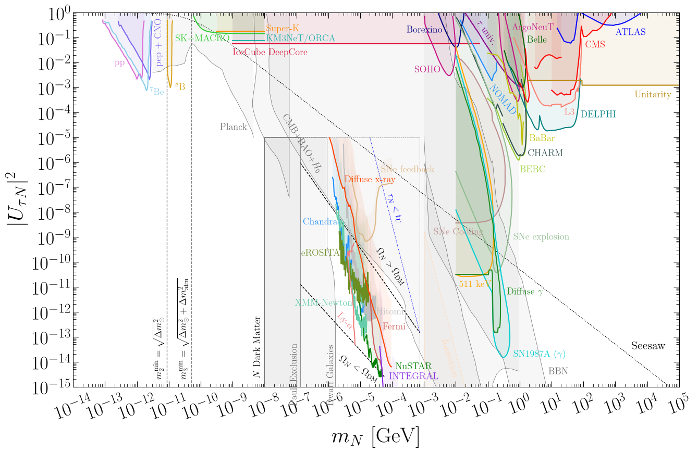
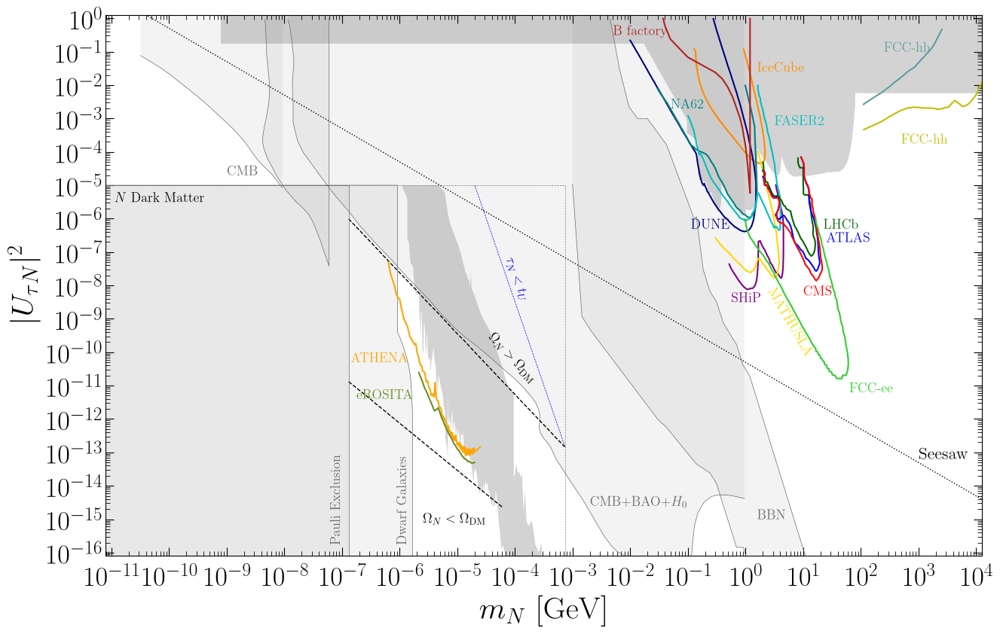

# Tau mixing - $|U_{\tau N}|^2$

## Current limits

| Experiment/Analysis | Type | Reference | Data | Shown |
|:-:|:-:|:-:|:-:|:-:|
| SNO + Super-K + SAGE/Gallex/GNO + Homestake + KamLAND | Oscillations |  [hep-ph/0403158](https://arxiv.org/abs/hep-ph/0403158) | [.csv](https://raw.githubusercontent.com/PatrickBolton/SterileNeutrinoConstraints/main/data/UtauNsq/current/Solar_Cirelli_tau.csv) | |
| pp (Borexino) | Oscillations |  [2205.07574](https://arxiv.org/abs/2205.07574) | [.csv](https://raw.githubusercontent.com/PatrickBolton/SterileNeutrinoConstraints/main/data/UtauNsq/current/pp_tau.csv) | ☑ |
| $^7\text{Be}$ (Borexino)  | Oscillations |  [2205.07574](https://arxiv.org/abs/2205.07574) | [.csv](https://raw.githubusercontent.com/PatrickBolton/SterileNeutrinoConstraints/main/data/UtauNsq/current/Be7_tau.csv) | ☑ |
| $^8\text{B}$ (Borexino)  | Oscillations |  [2205.07574](https://arxiv.org/abs/2205.07574) | [.csv](https://raw.githubusercontent.com/PatrickBolton/SterileNeutrinoConstraints/main/data/UtauNsq/current/B8_tau.csv) | ☑ |
| pep + CNO (Borexino)  | Oscillations |  [2205.07574](https://arxiv.org/abs/2205.07574) | [.csv](https://raw.githubusercontent.com/PatrickBolton/SterileNeutrinoConstraints/main/data/UtauNsq/current/pep_CNO_tau.csv) | ☑ |
| Super-K | Oscillations | [1410.2008](https://arxiv.org/abs/1410.2008) | [.csv](https://raw.githubusercontent.com/PatrickBolton/SterileNeutrinoConstraints/main/data/UtauNsq/current/SuperK_tau.csv) | ☑ |
| Super-K + MACRO | Oscillations |  [hep-ph/0403158](https://arxiv.org/abs/hep-ph/0403158) | [.csv](https://raw.githubusercontent.com/PatrickBolton/SterileNeutrinoConstraints/main/data/UtauNsq/current/atmospheric_Cirelli_tau.csv) | ☑ |
| KM3NeT/ORCA | Oscillations | [2510.07360](https://arxiv.org/abs/2510.07360) | [.csv](https://raw.githubusercontent.com/PatrickBolton/SterileNeutrinoConstraints/main/data/UtauNsq/current/KM3NeT_ORCA_tau.csv) | ☑ |
| IceCube DeepCore | Oscillations | [2407.01314](https://arxiv.org/abs/2407.01314) | [.csv](https://raw.githubusercontent.com/PatrickBolton/SterileNeutrinoConstraints/main/data/UtauNsq/current/DeepCore_tau.csv) | ☑ |
| $\tau$ universality | Lepton/meson decays | [1702.04335](https://arxiv.org/abs/1702.04335) | [.csv](https://raw.githubusercontent.com/PatrickBolton/SterileNeutrinoConstraints/main/data/UtauNsq/current/tau_universality.csv) | ☑ |
| Borexino | Decay in flight | [2010.09523](https://arxiv.org/abs/2010.09523) | [.csv](https://raw.githubusercontent.com/PatrickBolton/SterileNeutrinoConstraints/main/data/UtauNsq/current/Borexino_tau.csv)| ☑ |
| SOHO | Decay in flight | [2608.19319](https://arxiv.org/abs/2608.19319) | [.csv](https://raw.githubusercontent.com/PatrickBolton/SterileNeutrinoConstraints/main/data/UtauNsq/current/SOHO.csv) | ☑ |
| NOMAD | Fixed target | [hep-ex/0101041](https://arxiv.org/abs/hep-ex/0101041) | [.csv](https://raw.githubusercontent.com/PatrickBolton/SterileNeutrinoConstraints/main/data/UtauNsq/current/NOMAD.csv) | ☑ |
| BEBC | Fixed target | [2208.00416](https://arxiv.org/abs/2208.00416) | [.csv](https://raw.githubusercontent.com/PatrickBolton/SterileNeutrinoConstraints/main/data/UtauNsq/current/BEBC_tau.csv) | ☑ |
| CHARM (Orloff) | Fixed target | [hep-ph/0208075](https://arxiv.org/abs/hep-ph/0208075) | [.csv](https://raw.githubusercontent.com/PatrickBolton/SterileNeutrinoConstraints/main/data/UtauNsq/current/CHARM_tau_1.csv) | ☑ |
| CHARM (Boiarska) | Fixed target | [2107.14685](https://arxiv.org/abs/2107.14685) | [.csv](https://raw.githubusercontent.com/PatrickBolton/SterileNeutrinoConstraints/main/data/UtauNsq/current/CHARM_tau_2.csv) | ☑ |
| ArgoNeuT | Fixed target | [2106.13684](https://arxiv.org/abs/2106.13684) | [.csv](https://raw.githubusercontent.com/PatrickBolton/SterileNeutrinoConstraints/main/data/UtauNsq/current/ArgoNeuT.csv) | ☑ |
| Belle | Collider | [2402.02580](https://arxiv.org/abs/2402.02580) | [.csv](https://raw.githubusercontent.com/PatrickBolton/SterileNeutrinoConstraints/main/data/UtauNsq/current/Belle_tau.csv) | ☑ |
| BaBar | Collider | [2207.09575](https://arxiv.org/abs/2207.09575) | [.csv](https://raw.githubusercontent.com/PatrickBolton/SterileNeutrinoConstraints/main/data/UtauNsq/current/BaBar_tau.csv) | ☑ |
| DELPHI | Collider | [Z.Phys.C 74 (1997) 57-71](https://doi.org/10.1007/s002880050370) | [.csv](https://raw.githubusercontent.com/PatrickBolton/SterileNeutrinoConstraints/main/data/UalphaNsq/current/DELPHI.csv) | ☑ |
| L3 | Collider | [Phys.Lett.B 295 (1992) 371-382](https://doi.org/10.1016/0370-2693(92)91579-X) | [.csv](https://raw.githubusercontent.com/PatrickBolton/SterileNeutrinoConstraints/main/data/UtauNsq/current/L3_tau.csv) | ☑ |
| ATLAS ($t\bar{t}$) | Collider | [2408.05000](https://arxiv.org/abs/2408.05000) | [.csv](https://raw.githubusercontent.com/PatrickBolton/SterileNeutrinoConstraints/main/data/UtauNsq/current/ATLAS_ttbar_tau.csv) | ☑ |
| ATLAS (same-sign $\ell$ VBF) | Collider | [2607.27307](https://arxiv.org/abs/2607.27307) | [.csv](https://raw.githubusercontent.com/PatrickBolton/SterileNeutrinoConstraints/main/data/UtauNsq/current/ATLAS_samesignl_VBF_tau.csv) | ☑ |
| CMS (1 prompt $\ell$ + 1 displaced $j$) | Collider | [2312.07484](https://arxiv.org/abs/2312.07484) | [.csv](https://raw.githubusercontent.com/PatrickBolton/SterileNeutrinoConstraints/main/data/UtauNsq/current/CMS_prompt1l_disp1j_tau.csv) | ☑ |
| CMS (1 prompt $\ell$ MDS) | Collider | [2402.18658](https://arxiv.org/abs/2402.18658) | [.csv](https://raw.githubusercontent.com/PatrickBolton/SterileNeutrinoConstraints/main/data/UtauNsq/current/CMS_prompt1l_MDS_tau.csv) | ☑ |
| CMS (3 prompt $\ell$) | Collider | [2403.00100](https://arxiv.org/abs/2403.00100) | [.csv](https://raw.githubusercontent.com/PatrickBolton/SterileNeutrinoConstraints/main/data/UtauNsq/current/CMS_prompt3l_tau.csv)  | ☑ |
| Global non-unitarity fit | Unitarity | [2306.01040](https://arxiv.org/abs/2306.01040) | [.csv](https://raw.githubusercontent.com/PatrickBolton/SterileNeutrinoConstraints/main/data/UtauNsq/current/unitarity_tau.csv)  | ☑ |
| SNe (Abazajian) | Astrophysics | [astro-ph/0101524](https://arxiv.org/abs/astro-ph/0101524) | [.csv](https://raw.githubusercontent.com/PatrickBolton/SterileNeutrinoConstraints/main/data/UtauNsq/current/SNe_Abazajian_tau.csv) ||
| SNe (Arguelles) | Astrophysics | [1605.00654](https://arxiv.org/abs/1605.00654) | [.csv](https://raw.githubusercontent.com/PatrickBolton/SterileNeutrinoConstraints/main/data/UtauNsq/current/SNe_Arguelles_tau.csv) ||
| SNe cooling | Astrophysics | [2311.00033](https://arxiv.org/abs/2311.00033) | [.csv](https://raw.githubusercontent.com/PatrickBolton/SterileNeutrinoConstraints/main/data/UtauNsq/current/SNe_cooling_tau.csv) | ☑ |
| SNe explosion | Astrophysics | [2311.00033](https://arxiv.org/abs/2311.00033) | [.csv](https://raw.githubusercontent.com/PatrickBolton/SterileNeutrinoConstraints/main/data/UtauNsq/current/SNe_explosion_tau.csv) | ☑ |
| SNe 511 keV | Astrophysics | [2311.00033](https://arxiv.org/abs/2311.00033) | [.csv](https://raw.githubusercontent.com/PatrickBolton/SterileNeutrinoConstraints/main/data/UtauNsq/current/SNe_511keV_tau.csv) | ☑ |
| SNe $\gamma$-ray | Astrophysics | [2311.00033](https://arxiv.org/abs/2311.00033) | [.csv](https://raw.githubusercontent.com/PatrickBolton/SterileNeutrinoConstraints/main/data/UtauNsq/current/SNe_gammaray_tau.csv) | ☑ |
| SNe diffuse $\gamma$ | Astrophysics | [2311.00033](https://arxiv.org/abs/2311.00033) | [.csv](https://raw.githubusercontent.com/PatrickBolton/SterileNeutrinoConstraints/main/data/UtauNsq/current/SNe_diffuse_tau.csv) | ☑ |
| X-ray bounds | Astrophysics | Go to [DM page](../docs/DM.md)| - | ☑ |
| Cosmological bounds | Cosmology | Go to [DM page](../docs/DM.md) | - | ☑ |

## Future sensitivities

| Experiment/Analysis | Type | Reference | Data | Shown |
|:-:|:-:|:-:|:-:|:-:|
| $B$ factory | Fixed target | [1412.4785](https://arxiv.org/abs/1412.4785) | [.csv](https://raw.githubusercontent.com/PatrickBolton/SterileNeutrinoConstraints/main/data/UtauNsq/current/B_factory_tau.csv) | ☑ |
| IceCube (Coloma) | Fixed target | [1707.08573](https://arxiv.org/abs/1707.08573) | [.csv](https://raw.githubusercontent.com/PatrickBolton/SterileNeutrinoConstraints/main/data/UtauNsq/current/IceCube_tau.csv) | ☑ |
| DUNE (Ballett) | Fixed target | [1905.00284](https://arxiv.org/abs/1905.00284) | [.csv](https://raw.githubusercontent.com/PatrickBolton/SterileNeutrinoConstraints/main/data/UtauNsq/current/DUNE_Ballett_tau.csv) | ☑ |
| NA62 | Fixed target | [1801.04207](https://arxiv.org/abs/1801.04207) | [.csv](https://raw.githubusercontent.com/PatrickBolton/SterileNeutrinoConstraints/main/data/UtauNsq/current/NA62_tau.csv) | ☑ |
| SHiP | Fixed target | [1811.00930](https://arxiv.org/abs/1811.00930) | [.csv](https://raw.githubusercontent.com/PatrickBolton/SterileNeutrinoConstraints/main/data/UtauNsq/current/SHiP_tau.csv) | ☑ |
| MATHUSLA | Fixed target | [1806.07396](https://arxiv.org/abs/1806.07396) | [.csv](https://raw.githubusercontent.com/PatrickBolton/SterileNeutrinoConstraints/main/data/UtauNsq/current/MATHUSLA_disp_tau.csv) | ☑ |
| ATLAS displaced | Collider | [1903.06100](https://arxiv.org/abs/1903.06100) | [.csv](https://raw.githubusercontent.com/PatrickBolton/SterileNeutrinoConstraints/main/data/UtauNsq/current/ATLAS_disp_tau.csv) | ☑ |
| CMS displaced | Collider | [1903.06100](https://arxiv.org/abs/1903.06100) | [.csv](https://raw.githubusercontent.com/PatrickBolton/SterileNeutrinoConstraints/main/data/UtauNsq/current/CMS_disp_tau.csv) | ☑ |
| LHCb displaced | Collider | [1903.06100](https://arxiv.org/abs/1903.06100) | [.csv](https://raw.githubusercontent.com/PatrickBolton/SterileNeutrinoConstraints/main/data/UtauNsq/current/LHCb_disp_tau.csv) | ☑ |
| HL-LHC | Collider | [1812.08750](https://arxiv.org/abs/1812.08750) | [.csv](https://raw.githubusercontent.com/PatrickBolton/SterileNeutrinoConstraints/main/data/UtauNsq/current/collider_14TeV_tau.csv) | ☑ |
| FCC-hh | Collider | [1812.08750](https://arxiv.org/abs/1812.08750) | [.csv](https://raw.githubusercontent.com/PatrickBolton/SterileNeutrinoConstraints/main/data/UtauNsq/current/collider_100TeV_tau.csv) | ☑ |
| FCC-ee | Collider | [1411.5230](https://arxiv.org/abs/1411.5230) | [.csv](https://raw.githubusercontent.com/PatrickBolton/SterileNeutrinoConstraints/main/data/UalphaNsq/future/FCC_ee.csv) | ☑ |

